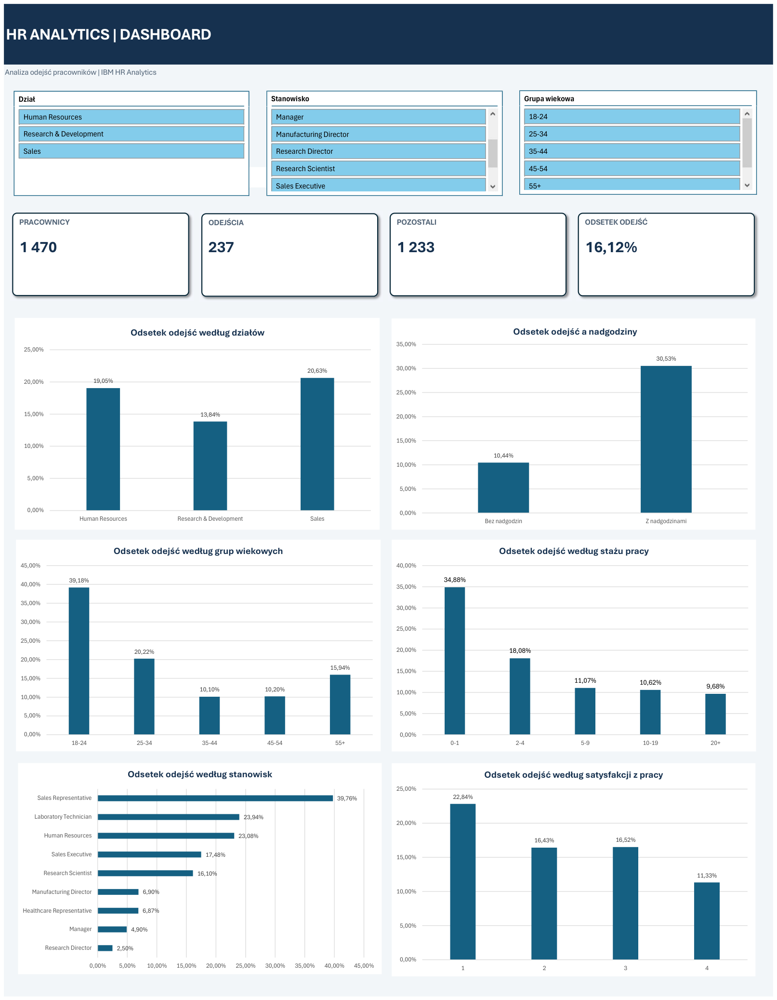

# HR Analytics — Analiza rotacji pracowników

## 1. Opis projektu

Projekt przedstawia analizę rotacji pracowników z wykorzystaniem programu Microsoft Excel.

Głównym celem jest zidentyfikowanie grup pracowników charakteryzujących się najwyższym odsetkiem odejść oraz zbadanie czynników związanych z rotacją.

Wyniki analizy przedstawiono w formie interaktywnego dashboardu HR, umożliwiającego przegląd najważniejszych wskaźników oraz porównywanie wyników pomiędzy poszczególnymi grupami pracowników.

## 2. Cele biznesowe

Projekt ma na celu udzielenie odpowiedzi na następujące pytania:

- Jaki odsetek pracowników odszedł z organizacji?
- W których działach występuje najwyższy odsetek odejść?
- Czy poziom wynagrodzenia jest powiązany z odejściami pracowników?
- Czy staż pracy ma związek z rotacją?
- Czy pracownicy wykonujący nadgodziny częściej odchodzą z organizacji?
- Jak poziom satysfakcji z pracy wiąże się z odejściami?
- Które grupy pracowników mogą wymagać szczególnej uwagi działu HR?

## 3. Wykorzystane narzędzia

- **Microsoft Excel** — analiza danych, obliczanie wskaźników i tworzenie dashboardu.
- **Power Query** — import, czyszczenie i transformacja danych.
- **Tabele przestawne** — agregacja danych i analiza porównawcza.
- **Wykresy i fragmentatory** — wizualizacja wyników oraz interaktywne filtrowanie danych.

## 4. Źródło danych

W projekcie wykorzystywany jest zbiór danych **IBM HR Analytics Employee Attrition & Performance**, dostępny na platformie Kaggle.

Źródło:
https://www.kaggle.com/datasets/pavansubhasht/ibm-hr-analytics-attrition-dataset

Zbiór zawiera 1470 rekordów opisujących pracowników oraz 35 zmiennych dotyczących m.in. wynagrodzeń, stażu pracy, działów, nadgodzin i satysfakcji zawodowej.

Dane mają charakter syntetyczny i służą do celów edukacyjnych oraz analitycznych. Nie przedstawiają rzeczywistych danych kadrowych firmy.

## 5. Struktura projektu

```text
HR_Analytics/
│
├── dashboard/
│   └── HR_Analytics.xlsx
│
├── data/
│   └── WA_Fn-UseC_-HR-Employee-Attrition.csv
│
├── images/
│   └── hr_dashboard.png
│
├── .gitignore
└──  README.md
```

**Opis katalogów i plików:**

- `dashboard/` — skoroszyt Excel zawierający analizę danych HR oraz interaktywny dashboard.
- `data/` — źródłowy zbiór danych w formacie CSV.
- `images/` — podgląd dashboardu wykorzystywany w dokumentacji.
- `README.md` — dokumentacja projektu.

## 6. Instrukcja uruchomienia projektu

Do uruchomienia projektu zalecana jest desktopowa wersja **Microsoft Excel 365** z obsługą Power Query, tabel przestawnych i fragmentatorów.

### 6.1. Pobranie i otwarcie projektu

1. Pobierz repozytorium z GitHub za pomocą opcji **Code → Download ZIP** i rozpakuj je na komputerze.
2. Otwórz plik `dashboard/HR_Analytics.xlsx` w programie Microsoft Excel.
3. Przejdź do arkusza `HR_Dashboard`, aby wyświetlić interaktywny dashboard.
4. Korzystaj z fragmentatorów, aby filtrować wyniki według działu, stanowiska i grupy wiekowej.

### 6.2. Aktualizacja ścieżki do danych źródłowych

Projekt wykorzystuje dane z pliku `data/WA_Fn-UseC_-HR-Employee-Attrition.csv`, importowane za pomocą Power Query.

Po przeniesieniu projektu na inny komputer może być konieczna aktualizacja ścieżki do pliku CSV.

Projekt przetestowano również po skopiowaniu do innej lokalizacji. Po ponownym nawiązaniu połączenia w programie Excel odświeżanie danych zakończyło się bez błędów. W przypadku problemów z odświeżaniem należy sprawdzić ścieżkę do pliku źródłowego zgodnie z poniższą instrukcją.

1. Otwórz skoroszyt `HR_Analytics.xlsx`.
2. Przejdź do zakładki **Dane → Zapytania i połączenia**.
3. Otwórz w edytorze Power Query zapytanie odpowiedzialne za import danych źródłowych.
4. W sekcji **Zastosowane kroki** wybierz krok **Źródło** i wskaż plik CSV znajdujący się w katalogu `data/`.
5. Zatwierdź zmianę i wybierz **Zamknij i załaduj**.
6. W programie Excel wybierz **Dane → Odśwież wszystko**, aby zaktualizować dane i powiązane tabele przestawne.

Po odświeżeniu sprawdź, czy dashboard wyświetla poprawne wskaźniki i czy fragmentatory działają prawidłowo.

### 6.3. Korzystanie z dashboardu

Dashboard umożliwia analizowanie odsetka odejść pracowników według wybranych kategorii.

Zmiana ustawień fragmentatorów powoduje aktualizację kart KPI oraz wykresów. Aby powrócić do wyników dla całego zbioru danych, należy wyczyścić filtry fragmentatorów.

## 7. Metodologia analizy

Analizę przeprowadzono w następujących etapach:

1. Import i weryfikacja danych źródłowych.
2. Czyszczenie i transformacja danych w Power Query.
3. Eksploracyjna analiza danych.
4. Obliczenie kluczowych wskaźników HR.
5. Przygotowanie tabel przestawnych i wizualizacji.
6. Budowa interaktywnego dashboardu.
7. Interpretacja wyników i opracowanie rekomendacji biznesowych.

## 8. Import i kontrola jakości danych

### 8.1. Import danych

Dane źródłowe zostały zaimportowane z pliku CSV do Microsoft Excel 365 przy użyciu Power Query.

Podczas importu wykonano następujące operacje:

- Wczytano dane z pliku `WA_Fn-UseC_-HR-Employee-Attrition.csv`.
- Ustawiono pierwszy wiersz jako nagłówki kolumn.
- Zastosowano automatyczne rozpoznawanie typów danych.
- Zweryfikowano liczbę rekordów i kolumn.

**Wynik importu:**
- Liczba rekordów: **1470**
- Liczba kolumn: **35**

### 8.2. Kontrola brakujących wartości i błędów

W Power Query utworzono dodatkowe zapytanie `HR_Data_Quality`, wykorzystujące odwołanie do głównego zbioru danych.

Zapytanie automatycznie sprawdza wszystkie 35 kolumn pod kątem:

- Brakujących wartości (`null`).
- Pustych ciągów tekstowych.
- Błędów danych (`Error`).

**Wyniki kontroli:**

| Kontrolowany element | Wynik |
|---|---:|
| Sprawdzone kolumny | 35 |
| Sprawdzone rekordy | 1470 |
| Brakujące wartości | 0 |
| Błędy danych | 0 |

Nie stwierdzono brakujących wartości ani błędów wymagających korekty.

### 8.3. Kontrola duplikatów

W celu wykrycia duplikatów utworzono zapytanie `HR_Duplicates_Check`.

Kontrolę przeprowadzono na podstawie kolumny `EmployeeNumber`, będącej identyfikatorem pracownika.

Dane pogrupowano według identyfikatora, a następnie sprawdzono, czy którykolwiek z nich występuje więcej niż jeden raz.

**Wynik:** 0 zduplikowanych identyfikatorów.

Oznacza to, że każdy pracownik posiada unikalny identyfikator w analizowanym zbiorze.

### 8.4. Podsumowanie kontroli jakości

Podstawowa kontrola jakości wykazała, że:

- Wszystkie 1470 rekordów zostało poprawnie wczytanych.
- Zbiór zawiera 35 kolumn.
- Nie wykryto brakujących wartości.
- Nie wykryto błędów danych.
- Nie stwierdzono powtarzających się identyfikatorów pracowników.

Na podstawie przeprowadzonych kontroli nie było konieczne usuwanie rekordów ani uzupełnianie brakujących danych.

## 9. Przygotowanie i transformacja danych

Transformacje danych przeprowadzono w Power Query w celu przygotowania zbioru do analizy eksploracyjnej oraz budowy interaktywnego dashboardu HR.

Utworzono zapytanie `HR_Cleaned_Data`, odwołujące się do oryginalnego zbioru danych. Dzięki temu dane źródłowe pozostały niezmienione, a wszystkie transformacje są zapisane jako kolejne kroki Power Query.

### 9.1. Usunięcie zbędnych kolumn

Zidentyfikowano i usunięto trzy kolumny zawierające identyczne wartości dla wszystkich pracowników:

| Kolumna | Stała wartość | Uzasadnienie |
|---|---|---|
| `EmployeeCount` | 1 | Nie wnosi dodatkowych informacji analitycznych. |
| `Over18` | Y | Wszyscy pracownicy są pełnoletni. |
| `StandardHours` | 80 | Wartość jest identyczna dla wszystkich rekordów. |

Liczba kolumn została zmniejszona z 35 do 32.

### 9.2. Weryfikacja typów danych

Zweryfikowano typy danych we wszystkich pozostałych kolumnach.

Potwierdzono poprawne przypisanie typów tekstowych do zmiennych kategorycznych oraz typów liczbowych do zmiennych ilościowych.

### 9.3. Utworzenie zmiennej Attrition_Flag

Utworzono kolumnę `Attrition_Flag`, przekształcającą informację o odejściu pracownika na wartość liczbową:

- `Yes` → 1 — pracownik odszedł.
- `No` → 0 — pracownik pozostał.

Zmienna umożliwia obliczanie liczby odejść oraz odsetka pracowników, którzy odeszli, w poszczególnych grupach.

### 9.4. Grupowanie pracowników według wieku

Na podstawie kolumny `Age` utworzono zmienną `Age_Group`.

Przyjęto pięć przedziałów wiekowych:

- 18–24 lata
- 25–34 lata
- 35–44 lata
- 45–54 lata
- 55 lat i więcej

Grupowanie umożliwia porównanie odsetka odejść pomiędzy grupami wiekowymi.

### 9.5. Grupowanie według wynagrodzenia

Na podstawie kolumny `MonthlyIncome` utworzono zmienną `Salary_Group`.

Przyjęto następujące przedziały miesięcznych wynagrodzeń:

- 0–2999
- 3000–4999
- 5000–7999
- 8000–11999
- 12000 i więcej

Przedziały zostały ustalone na potrzeby analizy i nie reprezentują oficjalnych kategorii wynagrodzeń. Nie przypisano im waluty, ponieważ nie została ona jednoznacznie określona w źródle danych.

### 9.6. Grupowanie według stażu pracy

Na podstawie kolumny `YearsAtCompany` utworzono zmienną `Tenure_Group`.

Zastosowano pięć kategorii:

- 0–1 rok
- 2–4 lata
- 5–9 lat
- 10–19 lat
- 20 lat i więcej

Podział umożliwia analizę zależności pomiędzy długością zatrudnienia a odsetkiem odejść pracowników.

### 9.7. Podsumowanie transformacji

| Element | Wynik |
|---|---:|
| Liczba rekordów | 1470 |
| Liczba kolumn przed transformacją | 35 |
| Usunięte kolumny | 3 |
| Dodane kolumny analityczne | 4 |
| Liczba kolumn po transformacji | 36 |

Przygotowany zbiór `HR_Cleaned_Data` posłużył jako podstawa analizy eksploracyjnej, obliczania wskaźników HR oraz budowy interaktywnego dashboardu.

Ze względu na brak dat odejść w zbiorze analizowany będzie odsetek pracowników oznaczonych jako osoby, które odeszły, a nie wskaźnik rotacji w określonym przedziale czasu.

### 9.8. Ładowanie danych do Excela

Po zakończeniu transformacji skonfigurowano sposób ładowania zapytań Power Query:

- Zapytanie źródłowe — tylko połączenie.
- `HR_Data_Quality` — tylko połączenie.
- `HR_Duplicates_Check` — tylko połączenie.
- `HR_Cleaned_Data` — tabela w arkuszu Excel.

Takie rozwiązanie pozwala zachować zapytania źródłowe i kontrolne bez tworzenia dodatkowych kopii danych w arkuszach.

Tabela `HR_Cleaned_Data` zawiera 1470 rekordów i 36 kolumn oraz stanowi podstawę dalszej analizy.

## 10. Analiza eksploracyjna danych (EDA)

### 10.1. Podstawowe wskaźniki HR

Pierwszym krokiem analizy eksploracyjnej było obliczenie podstawowych wskaźników dotyczących zatrudnienia i odejść pracowników.

W arkuszu `HR_Analysis` wykorzystano formuły programu Excel 365 odwołujące się do tabeli `HR_Cleaned_Data`.

| Wskaźnik | Wynik |
|---|---:|
| Liczba pracowników | 1470 |
| Liczba odejść | 237 |
| Liczba pozostałych pracowników | 1233 |
| Odsetek odejść | 16,12% |

**Interpretacja wyników:**

Spośród 1470 pracowników uwzględnionych w zbiorze danych 237 zostało oznaczonych jako osoby, które odeszły z organizacji.

Oznacza to, że odsetek odejść w analizowanej populacji wynosi 16,12%.

Ze względu na brak informacji o datach odejść oraz okresie obserwacji wynik ten nie stanowi rocznego wskaźnika rotacji pracowników.

Obliczone wartości stanowią punkt odniesienia do dalszych analiz porównawczych, obejmujących m.in. działy, poziomy wynagrodzeń, wiek oraz staż pracy.

### 10.2. Analiza odejść pracowników według działów

W celu porównania poziomu odejść pracowników pomiędzy działami utworzono tabelę przestawną w programie Excel.

W analizie wykorzystano:

- `Department` — dział pracownika.
- `EmployeeNumber` — liczba pracowników (Licznik).
- `Attrition_Flag` — liczba odejść (Suma).
- `Attrition_Flag` — odsetek odejść (Średnia).

**Wyniki analizy:**

| Dział | Liczba pracowników | Liczba odejść | Odsetek odejść |
|---|---:|---:|---:|
| Human Resources | 63 | 12 | 19,05% |
| Research & Development | 961 | 133 | 13,84% |
| Sales | 446 | 92 | 20,63% |
| **Łącznie** | **1470** | **237** | **16,12%** |

**Najważniejsze obserwacje:**

1. Najwyższy odsetek odejść występuje w dziale Sales (20,63%).
2. Dział Human Resources charakteryzuje się odsetkiem odejść wynoszącym 19,05%, ale obejmuje stosunkowo niewielką grupę pracowników (63 osoby).
3. Research & Development odpowiada za największą bezwzględną liczbę odejść (133), jednak odsetek odejść w tym dziale jest najniższy (13,84%).
4. Odsetek odejść w Sales jest o 4,51 punktu procentowego wyższy od wyniku dla całej organizacji.

**Wniosek biznesowy:**

Dział Sales powinien zostać uwzględniony jako jeden z priorytetowych obszarów dalszej analizy HR ze względu na najwyższy odsetek odejść.

Wysoka liczba odejść w Research & Development wynika częściowo z większej liczebności tego działu. Pokazuje to, dlaczego porównywanie samych liczb odejść może prowadzić do błędnych interpretacji.

### 10.3. Analiza zależności między nadgodzinami a odejściami

W celu zbadania związku pomiędzy wykonywaniem nadgodzin a odejściami pracowników przygotowano tabelę przestawną na podstawie zmiennej `OverTime`.

Dla każdej grupy obliczono liczbę pracowników, liczbę odejść oraz odsetek odejść.

**Wyniki analizy:**

| Nadgodziny | Liczba pracowników | Liczba odejść | Odsetek odejść |
|---|---:|---:|---:|
| Nie | 1054 | 110 | 10,44% |
| Tak | 416 | 127 | 30,53% |
| **Łącznie** | **1470** | **237** | **16,12%** |

**Najważniejsze obserwacje:**

1. Wśród pracowników wykonujących nadgodziny odsetek odejść wynosi 30,53%.
2. Wśród pracowników niewykonujących nadgodzin odsetek odejść wynosi 10,44%.
3. Różnica pomiędzy grupami wynosi 20,09 punktu procentowego.
4. Odsetek odejść wśród osób wykonujących nadgodziny jest około 2,9 razy wyższy niż wśród pracowników bez nadgodzin.

**Wniosek biznesowy:**

Wykonywanie nadgodzin jest silnie powiązane z odejściami pracowników w analizowanym zbiorze danych.

Zależność tę pogłębiono w dalszych analizach przekrojowych, porównując odsetki odejść wśród pracowników wykonujących i niewykonujących nadgodzin na poszczególnych stanowiskach (sekcja 10.9) oraz na różnych poziomach satysfakcji z pracy (sekcja 10.12). Wyniki wskazują również na zasadność dalszego zbadania organizacji czasu pracy i obciążenia pracowników.

### 10.4. Analiza odejść według grup wiekowych

W celu zbadania zależności między wiekiem pracowników a odejściami przygotowano tabelę przestawną na podstawie zmiennej `Age_Group`.

Dla każdej grupy obliczono liczbę pracowników, liczbę odejść oraz odsetek odejść.

**Wyniki analizy:**

| Grupa wiekowa | Liczba pracowników | Liczba odejść | Odsetek odejść |
|---|---:|---:|---:|
| 18–24 | 97 | 38 | 39,18% |
| 25–34 | 554 | 112 | 20,22% |
| 35–44 | 505 | 51 | 10,10% |
| 45–54 | 245 | 25 | 10,20% |
| 55+ | 69 | 11 | 15,94% |
| **Łącznie** | **1470** | **237** | **16,12%** |

**Najważniejsze obserwacje:**

1. Najwyższy odsetek odejść występuje wśród pracowników w wieku 18–24 lata (39,18%).
2. Odsetek odejść w najmłodszej grupie jest około 2,43 razy wyższy niż w całej analizowanej populacji.
3. Największą bezwzględną liczbę odejść odnotowano w grupie 25–34 lata (112 osób).
4. Najniższy odsetek odejść występuje w grupie 35–44 lata (10,10%).
5. W grupie 55+ odsetek odejść wynosi 15,94%, jednak jej stosunkowo niewielka liczebność wymaga ostrożnej interpretacji.

**Wniosek biznesowy:**

Najmłodsi pracownicy stanowią grupę wymagającą szczególnej uwagi w dalszej analizie HR.

Zależności te pogłębiono w trzech analizach przekrojowych, porównując wiek pracowników ze stażem pracy (sekcja 10.10), zajmowanym stanowiskiem (sekcja 10.13) oraz poziomem wynagrodzenia (sekcja 10.15). Wyniki pozwoliły dokładniej zidentyfikować grupy młodszych pracowników charakteryzujące się podwyższonym odsetkiem odejść.

### 10.5. Analiza odejść według stażu pracy

W celu zbadania zależności pomiędzy długością zatrudnienia a odejściami pracowników przygotowano tabelę przestawną na podstawie zmiennej `Tenure_Group`.

Dla każdej grupy obliczono liczbę pracowników, liczbę odejść oraz odsetek odejść.

**Wyniki analizy:**

| Staż pracy | Liczba pracowników | Liczba odejść | Odsetek odejść |
|---|---:|---:|---:|
| 0–1 rok | 215 | 75 | 34,88% |
| 2–4 lata | 365 | 66 | 18,08% |
| 5–9 lat | 524 | 58 | 11,07% |
| 10–19 lat | 273 | 29 | 10,62% |
| 20+ lat | 93 | 9 | 9,68% |
| **Łącznie** | **1470** | **237** | **16,12%** |

**Najważniejsze obserwacje:**

1. Najwyższy odsetek odejść występuje w grupie pracowników ze stażem 0–1 rok (34,88%).
2. Wśród pracowników ze stażem 2–4 lata odsetek odejść wynosi 18,08%.
3. W grupach o stażu wynoszącym co najmniej 5 lat odsetek odejść utrzymuje się na poziomie około 9,7–11,1%.
4. Odsetek odejść w grupie 0–1 rok jest około 3,6 razy wyższy niż w grupie 20+ lat.
5. Wraz ze wzrostem stażu pracy obserwowany odsetek odejść generalnie maleje.

**Wniosek biznesowy:**

Pracownicy znajdujący się na początku zatrudnienia stanowią istotną grupę z perspektywy działań HR.

Warto przeanalizować proces wdrażania nowych pracowników (onboarding), wsparcie ze strony przełożonych oraz oczekiwania dotyczące stanowiska.

### 10.6. Analiza odejść według poziomu wynagrodzenia

W celu zbadania związku między poziomem miesięcznego wynagrodzenia a odejściami pracowników utworzono tabelę przestawną na podstawie zmiennej `Salary_Group`.

Dla każdego przedziału wynagrodzenia obliczono liczbę pracowników, liczbę odejść oraz odsetek odejść.

**Wyniki analizy:**

| Przedział wynagrodzenia | Pracownicy | Odejścia | Odsetek odejść |
|---|---:|---:|---:|
| 0–2999 | 395 | 113 | 28,61% |
| 3000–4999 | 354 | 50 | 14,12% |
| 5000–7999 | 340 | 34 | 10,00% |
| 8000–11999 | 186 | 29 | 15,59% |
| 12000+ | 195 | 11 | 5,64% |
| **Łącznie** | **1470** | **237** | **16,12%** |

**Najważniejsze obserwacje:**

1. Najwyższy odsetek odejść występuje wśród pracowników z miesięcznym wynagrodzeniem poniżej 3000 (28,61%).
2. Pracownicy z najniższego przedziału wynagrodzeń odpowiadają za około 47,7% wszystkich odejść.
3. Najniższy odsetek odejść występuje w grupie wynagrodzeń 12000+ (5,64%).
4. Odsetek odejść w najniższej grupie wynagrodzeń jest około 5,1 razy wyższy niż w najwyższej.
5. Zależność nie jest całkowicie liniowa — w grupie 8000–11999 odsetek odejść jest wyższy niż w grupie 5000–7999.

**Wniosek biznesowy:**

Pracownicy z najniższymi wynagrodzeniami stanowią grupę wymagającą szczególnej uwagi podczas dalszej analizy HR.

Zależności te pogłębiono w analizach przekrojowych, uwzględniając poziom wynagrodzenia w połączeniu ze stażem pracy (sekcja 10.11), stanowiskiem (sekcja 10.14) oraz grupą wiekową (sekcja 10.15). Wyniki pokazały, że podwyższony odsetek odejść wśród pracowników z niższymi wynagrodzeniami różni się w zależności od pozostałych analizowanych cech.

### 10.7. Analiza odejść według satysfakcji z pracy

W celu zbadania zależności pomiędzy poziomem satysfakcji zawodowej a odejściami pracowników przygotowano tabelę przestawną na podstawie zmiennej `JobSatisfaction`.

Poziom satysfakcji został przedstawiony w czterostopniowej skali:

- 1 — niska satysfakcja.
- 2 — średnia satysfakcja.
- 3 — wysoka satysfakcja.
- 4 — bardzo wysoka satysfakcja.

**Wyniki analizy:**

| Poziom satysfakcji | Pracownicy | Odejścia | Odsetek odejść |
|---|---:|---:|---:|
| 1 — Niska | 289 | 66 | 22,84% |
| 2 — Średnia | 280 | 46 | 16,43% |
| 3 — Wysoka | 442 | 73 | 16,52% |
| 4 — Bardzo wysoka | 459 | 52 | 11,33% |
| **Łącznie** | **1470** | **237** | **16,12%** |

**Najważniejsze obserwacje:**

1. Najwyższy odsetek odejść występuje w grupie pracowników o najniższym poziomie satysfakcji (22,84%).
2. Najniższy odsetek odejść odnotowano w grupie o bardzo wysokiej satysfakcji (11,33%).
3. Różnica pomiędzy skrajnymi grupami wynosi 11,51 punktu procentowego.
4. Odsetek odejść w grupie o najniższej satysfakcji jest około dwukrotnie wyższy niż w grupie o najwyższej satysfakcji.
5. Grupy o poziomach satysfakcji 2 i 3 wykazują zbliżony odsetek odejść.

**Wniosek biznesowy:**

Niski poziom satysfakcji z pracy jest powiązany z podwyższonym odsetkiem odejść pracowników.

Zależność tę pogłębiono w analizie przekrojowej uwzględniającej poziom satysfakcji z pracy oraz wykonywanie nadgodzin (sekcja 10.12). Wyniki wskazują również na zasadność dalszego zbadania organizacji obowiązków, relacji z przełożonymi oraz możliwości rozwoju zawodowego.

### 10.8. Analiza odejść według stanowisk

W celu identyfikacji stanowisk charakteryzujących się najwyższym odsetkiem odejść przygotowano tabelę przestawną na podstawie zmiennej `JobRole`.

Dla każdego stanowiska obliczono liczbę pracowników, liczbę odejść oraz odsetek odejść.

**Wyniki analizy:**

| Stanowisko | Pracownicy | Odejścia | Odsetek odejść |
|---|---:|---:|---:|
| Sales Representative | 83 | 33 | 39,76% |
| Laboratory Technician | 259 | 62 | 23,94% |
| Human Resources | 52 | 12 | 23,08% |
| Sales Executive | 326 | 57 | 17,48% |
| Research Scientist | 292 | 47 | 16,10% |
| Manufacturing Director | 145 | 10 | 6,90% |
| Healthcare Representative | 131 | 9 | 6,87% |
| Manager | 102 | 5 | 4,90% |
| Research Director | 80 | 2 | 2,50% |
| **Łącznie** | **1470** | **237** | **16,12%** |

**Najważniejsze obserwacje:**

1. Najwyższy odsetek odejść występuje na stanowisku Sales Representative (39,76%).
2. Odsetek odejść wśród Sales Representative jest około 2,47 razy wyższy niż w całej organizacji.
3. Największą bezwzględną liczbę odejść odnotowano wśród Laboratory Technician (62 osoby).
4. Podwyższony odsetek odejść występuje również na stanowisku Human Resources (23,08%).
5. Najniższy odsetek odejść występuje na stanowisku Research Director (2,50%).

**Wniosek biznesowy:**

Stanowiska Sales Representative i Laboratory Technician stanowią istotne obszary dalszej analizy HR ze względu na odpowiednio najwyższy odsetek odejść i największą liczbę odejść.

Analizę pogłębiono, uwzględniając stanowiska w połączeniu z wykonywaniem nadgodzin (sekcja 10.9), grupą wiekową (sekcja 10.13) oraz poziomem wynagrodzenia (sekcja 10.14). Dalszej weryfikacji wymaga natomiast związek pomiędzy stażem pracy na poszczególnych stanowiskach a odsetkiem odejść.

### 10.9. Analiza przekrojowa — stanowisko a nadgodziny

W celu pogłębienia analizy odejść pracowników przeprowadzono analizę przekrojową uwzględniającą jednocześnie stanowisko (`JobRole`) oraz wykonywanie nadgodzin (`OverTime`).

W tabeli przestawnej obliczono liczebność poszczególnych grup oraz odsetek odejść wśród pracowników wykonujących i niewykonujących nadgodzin.

**Wybrane wyniki analizy:**

| Stanowisko | Bez nadgodzin | Z nadgodzinami | Różnica (p.p.) |
|---|---:|---:|---:|
| Sales Representative | 28,81% | 66,67% | +37,86 |
| Laboratory Technician | 15,74% | 50,00% | +34,26 |
| Research Scientist | 7,18% | 34,02% | +26,84 |
| Sales Executive | 11,21% | 32,98% | +21,77 |
| Human Resources | 17,95% | 38,46% | +20,51 |
| Manager | 1,33% | 14,81% | +13,48 |

**Najważniejsze obserwacje:**

1. Wśród Sales Representative wykonujących nadgodziny odsetek odejść wynosi 66,67% (16 z 24 pracowników).
2. Wśród Laboratory Technician wykonujących nadgodziny odsetek odejść wynosi 50,00% (31 z 62 pracowników).
3. Wśród Research Scientist i Sales Executive odsetek odejść jest znacznie wyższy w grupach wykonujących nadgodziny.
4. W większości analizowanych stanowisk nadgodziny współwystępują z wyższym odsetkiem odejść.
5. Wyjątkiem jest stanowisko Healthcare Representative, gdzie odsetek odejść jest nieco niższy wśród pracowników wykonujących nadgodziny.

**Wniosek biznesowy:**

Wyniki wskazują, że wykonywanie nadgodzin jest istotnie powiązane z podwyższonym odsetkiem odejść na wybranych stanowiskach.

Szczególną uwagę warto poświęcić stanowiskom Sales Representative oraz Laboratory Technician.

Rekomendowane jest przeanalizowanie obciążenia pracą, organizacji nadgodzin oraz satysfakcji pracowników na tych stanowiskach.

### 10.10. Analiza przekrojowa — wiek a staż pracy

W celu pogłębienia analizy odejść pracowników przygotowano tabelę przestawną uwzględniającą jednocześnie grupę wiekową (`Age_Group`) oraz staż pracy (`Tenure_Group`).

Dla każdej kombinacji obliczono liczbę pracowników oraz odsetek odejść.

**Wybrane wyniki analizy:**

| Grupa wiekowa | Staż pracy | Pracownicy | Odsetek odejść |
|---|---|---:|---:|
| 18–24 | 0–1 rok | 43 | 60,47% |
| 18–24 | 2–4 lata | 42 | 21,43% |
| 25–34 | 0–1 rok | 66 | 43,94% |
| 25–34 | 2–4 lata | 152 | 25,66% |
| 25–34 | 5–9 lat | 230 | 13,04% |
| 35–44 | 0–1 rok | 75 | 20,00% |
| 35–44 | 5–9 lat | 174 | 6,90% |

**Najważniejsze obserwacje:**

1. Najwyższy odsetek odejść występuje wśród pracowników w wieku 18–24 lata ze stażem 0–1 rok (60,47%, czyli 26 z 43 osób).
2. Wśród pracowników w wieku 25–34 lata ze stażem 0–1 rok odsetek odejść wynosi 43,94%.
3. W grupie wiekowej 25–34 lata obserwowany odsetek odejść maleje wraz ze wzrostem stażu pracy.
4. Wśród osób o podobnym stażu występują różnice w odsetku odejść pomiędzy grupami wiekowymi.
5. Niektóre kombinacje wieku i stażu obejmują niewielką liczbę pracowników, co ogranicza możliwość uogólniania wyników.

**Wniosek biznesowy:**

Młodzi pracownicy znajdujący się na początku zatrudnienia stanowią grupę wymagającą szczególnej uwagi działu HR.

Warto dokładniej przeanalizować proces wdrażania nowych pracowników, jakość onboardingu oraz zgodność oczekiwań pracowników z rzeczywistymi obowiązkami.

### 10.11. Analiza przekrojowa — wynagrodzenie a staż pracy

W celu pogłębienia analizy odejść pracowników przygotowano tabelę przestawną uwzględniającą jednocześnie poziom wynagrodzenia (`Salary_Group`) oraz długość zatrudnienia (`Tenure_Group`).

Dla każdej kombinacji obliczono liczbę pracowników i odsetek odejść.

**Wybrane wyniki analizy:**

| Przedział wynagrodzenia | Staż pracy | Pracownicy | Odsetek odejść |
|---|---|---:|---:|
| 0–2999 | 0–1 rok | 122 | 45,90% |
| 0–2999 | 2–4 lata | 140 | 23,57% |
| 0–2999 | 5–9 lat | 110 | 17,27% |
| 3000–4999 | 0–1 rok | 34 | 26,47% |
| 5000–7999 | 5–9 lat | 160 | 10,00% |
| 12000+ | 5–9 lat | 44 | 4,55% |
| 12000+ | 10–19 lat | 40 | 5,00% |

**Najważniejsze obserwacje:**

1. Najwyższy odsetek odejść wśród liczniejszych analizowanych grup występuje u pracowników z wynagrodzeniem poniżej 3000 i stażem 0–1 rok (45,90%, czyli 56 z 122 osób).
2. W grupie najniższych wynagrodzeń podwyższony odsetek odejść występuje również wśród pracowników z dłuższym stażem.
3. Pracownicy z najwyższego przedziału wynagrodzeń (12000+) charakteryzują się stosunkowo niskim odsetkiem odejść w większości przedziałów stażu.
4. Zależność pomiędzy wynagrodzeniem, stażem pracy i odejściami nie jest całkowicie liniowa.
5. Niektóre kombinacje obejmują niewielką liczbę pracowników, dlatego ich wyniki wymagają ostrożnej interpretacji.

**Wniosek biznesowy:**

Pracownicy o najniższych wynagrodzeniach i krótkim stażu stanowią istotną grupę z perspektywy dalszej analizy HR.

Warto rozważyć analizę konkurencyjności wynagrodzeń, procesu wdrażania pracowników oraz możliwości rozwoju zawodowego.

### 10.12. Analiza przekrojowa — satysfakcja z pracy a nadgodziny

W celu pogłębienia analizy odejść pracowników przygotowano tabelę przestawną uwzględniającą jednocześnie poziom satysfakcji z pracy (`JobSatisfaction`) oraz wykonywanie nadgodzin (`OverTime`).

Dla każdej kombinacji obliczono liczbę pracowników oraz odsetek odejść.

**Wyniki analizy:**

| Poziom satysfakcji | Bez nadgodzin | Z nadgodzinami | Różnica (p.p.) |
|---|---:|---:|---:|
| 1 — Niska | 17,56% | 35,71% | +18,15 |
| 2 — Średnia | 9,48% | 37,68% | +28,20 |
| 3 — Wysoka | 9,97% | 33,88% | +23,91 |
| 4 — Bardzo wysoka | 6,94% | 21,13% | +14,19 |
| **Łącznie** | **10,44%** | **30,53%** | **+20,09** |

**Najważniejsze obserwacje:**

1. Na każdym poziomie satysfakcji pracownicy wykonujący nadgodziny charakteryzują się wyższym odsetkiem odejść.
2. Największa różnica występuje w grupie o poziomie satysfakcji 2 i wynosi 28,20 punktu procentowego.
3. Wśród pracowników o najwyższym poziomie satysfakcji odsetek odejść wynosi 6,94% bez nadgodzin oraz 21,13% przy wykonywaniu nadgodzin.
4. Nawet bardzo wysoka satysfakcja z pracy nie eliminuje obserwowanej zależności między nadgodzinami a odejściami.
5. Wśród pracowników wykonujących nadgodziny najwyższy poziom satysfakcji współwystępuje z niższym odsetkiem odejść niż pozostałe poziomy satysfakcji.

**Wniosek biznesowy:**

Wyniki sugerują, że działania dotyczące satysfakcji pracowników powinny być rozpatrywane wspólnie z analizą obciążenia pracą.

Warto monitorować nadgodziny oraz badać ich współwystępowanie z satysfakcją i odejściami pracowników.

### 10.13. Analiza przekrojowa — stanowisko a grupa wiekowa

W celu pogłębienia analizy odejść pracowników przygotowano tabelę przestawną uwzględniającą jednocześnie stanowisko (`JobRole`) oraz grupę wiekową (`Age_Group`).

Dla każdej kombinacji obliczono liczbę pracowników oraz odsetek odejść.

**Wybrane wyniki analizy:**

| Stanowisko | Grupa wiekowa | Pracownicy | Odejścia | Odsetek odejść |
|---|---|---:|---:|---:|
| Sales Representative | 18–24 | 23 | 13 | 56,52% |
| Sales Representative | 25–34 | 38 | 15 | 39,47% |
| Laboratory Technician | 18–24 | 32 | 14 | 43,75% |
| Laboratory Technician | 25–34 | 107 | 31 | 28,97% |
| Human Resources | 25–34 | 22 | 8 | 36,36% |
| Research Scientist | 25–34 | 144 | 28 | 19,44% |
| Sales Executive | 25–34 | 144 | 24 | 16,67% |

**Najważniejsze obserwacje:**

1. Najwyższy odsetek odejść wśród analizowanych liczniejszych grup występuje na stanowisku Sales Representative w wieku 18–24 lata (56,52%).
2. Wśród Sales Representative poniżej 35. roku życia odnotowano 28 z 33 wszystkich odejść na tym stanowisku.
3. W przypadku Laboratory Technician pracownicy poniżej 35. roku życia odpowiadają za 45 z 62 odejść.
4. Na stanowisku Research Scientist odsetek odejść jest wyższy w młodszych grupach wiekowych.
5. Niektóre kombinacje obejmują bardzo niewielką liczbę pracowników, dlatego ich wyniki należy interpretować ostrożnie.

**Wniosek biznesowy:**

Szczególną uwagę warto poświęcić młodszym pracownikom na stanowiskach Sales Representative i Laboratory Technician.

W dalszych analizach przekrojowych uwzględniono wynagrodzenia w podziale na stanowiska (sekcja 10.14) oraz grupy wiekowe (sekcja 10.15). Dodatkowej analizy wymaga natomiast połączenie wieku, stanowiska, stażu pracy i obciążenia nadgodzinami, aby dokładniej scharakteryzować wskazane grupy pracowników.

### 10.14. Analiza przekrojowa — stanowisko a wynagrodzenie

W celu pogłębienia analizy odejść pracowników przygotowano tabelę przestawną uwzględniającą jednocześnie stanowisko (`JobRole`) oraz przedział miesięcznego wynagrodzenia (`Salary_Group`).

Dla każdej kombinacji obliczono liczbę pracowników oraz odsetek odejść.

**Wybrane wyniki analizy:**

| Stanowisko | Przedział wynagrodzenia | Pracownicy | Odsetek odejść |
|---|---|---:|---:|
| Sales Representative | 0–2999 | 68 | 41,18% |
| Sales Representative | 3000–4999 | 13 | 38,46% |
| Laboratory Technician | 0–2999 | 135 | 29,63% |
| Laboratory Technician | 3000–4999 | 99 | 19,19% |
| Laboratory Technician | 5000–7999 | 25 | 12,00% |
| Research Scientist | 0–2999 | 166 | 21,08% |
| Research Scientist | 3000–4999 | 100 | 12,00% |
| Sales Executive | 3000–4999 | 80 | 12,50% |
| Sales Executive | 8000–11999 | 85 | 21,18% |

**Najważniejsze obserwacje:**

1. Na stanowisku Sales Representative wysoki odsetek odejść występuje zarówno w grupie wynagrodzeń 0–2999 (41,18%), jak i 3000–4999 (38,46%).
2. Wśród Laboratory Technician odsetek odejść maleje z 29,63% do 12,00% wraz z przechodzeniem do wyższych przedziałów wynagrodzenia.
3. Podobny wzorzec obserwowany jest na stanowisku Research Scientist.
4. Na stanowisku Sales Executive zależność jest odmienna — w wybranych wyższych przedziałach wynagrodzenia odsetek odejść jest wyższy.
5. Część kombinacji stanowiska i wynagrodzenia obejmuje niewielkie grupy pracowników, co ogranicza możliwość uogólniania wyników.

**Wniosek biznesowy:**

Zależność pomiędzy poziomem wynagrodzenia a odejściami pracowników różni się w zależności od zajmowanego stanowiska.

W przypadku Laboratory Technician i Research Scientist warto dokładniej zbadać konkurencyjność wynagrodzeń oraz możliwości rozwoju zawodowego.

Dla Sales Representative należy uwzględnić również inne czynniki, szczególnie wykonywanie nadgodzin i obciążenie pracą.

### 10.15. Analiza przekrojowa — wynagrodzenie a grupa wiekowa

W celu pogłębienia analizy odejść pracowników przygotowano tabelę przestawną uwzględniającą jednocześnie przedział miesięcznego wynagrodzenia (`Salary_Group`) oraz grupę wiekową (`Age_Group`).

Dla każdej kombinacji obliczono liczbę pracowników oraz odsetek odejść.

**Wybrane wyniki analizy:**

| Przedział wynagrodzenia | Grupa wiekowa | Pracownicy | Odsetek odejść |
|---|---|---:|---:|
| 0–2999 | 18–24 | 72 | 44,44% |
| 0–2999 | 25–34 | 188 | 30,85% |
| 0–2999 | 35–44 | 101 | 15,84% |
| 3000–4999 | 18–24 | 25 | 24,00% |
| 3000–4999 | 25–34 | 164 | 15,85% |
| 5000–7999 | 25–34 | 134 | 12,69% |
| 5000–7999 | 35–44 | 146 | 6,85% |
| 12000+ | 35–44 | 66 | 6,06% |
| 12000+ | 45–54 | 92 | 3,26% |

**Najważniejsze obserwacje:**

1. Najwyższy odsetek odejść wśród liczniejszych analizowanych grup występuje u pracowników w wieku 18–24 lata z wynagrodzeniem poniżej 3000 (44,44%).
2. W grupie 25–34 lata i wynagrodzeniu 0–2999 odsetek odejść wynosi 30,85%.
3. W obrębie tej samej grupy wiekowej niższe wynagrodzenia często współwystępują z wyższym odsetkiem odejść, choć zależność nie jest całkowicie liniowa.
4. Wśród pracowników w wieku 45–54 lata otrzymujących wynagrodzenie 12000+ odsetek odejść wynosi 3,26%.
5. Wyniki małych grup należy interpretować ostrożnie, ponieważ pojedyncze odejścia mogą znacząco wpływać na odsetki.

**Wniosek biznesowy:**

Młodsi pracownicy z niższych przedziałów wynagrodzenia stanowią istotną grupę do dalszej analizy HR.

W pozostałych analizach przekrojowych zbadano powiązania wieku ze stażem pracy (sekcja 10.10), wynagrodzenia ze stażem (sekcja 10.11) oraz wynagrodzenia ze stanowiskiem (sekcja 10.14). Dalszej analizy wymaga natomiast łączne uwzględnienie tych cech oraz wykonywania nadgodzin, aby dokładniej scharakteryzować grupy młodszych pracowników o niższych wynagrodzeniach.

### 10.16. Podsumowanie analizy eksploracyjnej i rekomendacje biznesowe

Przeprowadzona analiza eksploracyjna objęła 1470 pracowników oraz 237 odejść, co odpowiada odsetkowi odejść wynoszącemu 16,12%.

Wykorzystano tabele przestawne programu Excel do analizy siedmiu czynników oraz siedmiu analiz przekrojowych, pozwalających zbadać współwystępowanie różnych cech pracowników z odejściami.

#### 10.16.1. Pięć najważniejszych wniosków

**1. Nadgodziny są jednym z najważniejszych czynników powiązanych z odejściami.**

Odsetek odejść wśród pracowników wykonujących nadgodziny wynosi 30,53%, wobec 10,44% wśród osób niewykonujących nadgodzin.

Zależność występuje również na większości analizowanych stanowisk oraz na każdym poziomie satysfakcji z pracy.

Szczególnie wysokie wartości zaobserwowano wśród Sales Representative wykonujących nadgodziny (66,67%, 16 z 24 osób) oraz Laboratory Technician (50,00%, 31 z 62 osób).

**2. Początkowy okres zatrudnienia wiąże się z podwyższonym odsetkiem odejść.**

Wśród pracowników ze stażem 0–1 rok odsetek odejść wynosi 34,88%, wobec 9,68% w grupie ze stażem co najmniej 20 lat.

Szczególnie wysoki wynik występuje wśród osób w wieku 18–24 lata ze stażem 0–1 rok — 60,47% (26 z 43 pracowników).

Wyniki wskazują na potrzebę dokładniejszej analizy procesu wdrażania i adaptacji nowych pracowników.

**3. Niskie wynagrodzenia współwystępują z wyższym odsetkiem odejść.**

W najniższym przedziale wynagrodzenia (0–2999) odsetek odejść wynosi 28,61%, podczas gdy w najwyższym przedziale (12000+) wynosi 5,64%.

Szczególnie istotna jest grupa pracowników z wynagrodzeniem poniżej 3000 oraz stażem 0–1 rok, w której odsetek odejść osiąga 45,90% (56 ze 122 osób).

Analizy przekrojowe wykazały jednak, że zależność pomiędzy wynagrodzeniem a odejściami różni się w zależności od stanowiska, wieku i stażu pracy.

**4. Największej uwagi wymagają wybrane stanowiska oraz grupy młodszych pracowników.**

Najwyższy odsetek odejść wśród stanowisk występuje na Sales Representative (39,76%).

Największą bezwzględną liczbę odejść odnotowano natomiast wśród Laboratory Technician (62 osoby).

Analiza wieku wykazała, że pracownicy w wieku 18–24 lata mają odsetek odejść wynoszący 39,18%.

Połączenie stanowiska i wieku ujawniło szczególnie wysokie odsetki odejść wśród Sales Representative w wieku 18–24 lata (56,52%) oraz Laboratory Technician w tej samej grupie wiekowej (43,75%).

**5. Satysfakcja z pracy jest powiązana z odejściami, ale nie eliminuje zależności związanej z nadgodzinami.**

Wśród pracowników o najniższym poziomie satysfakcji odsetek odejść wynosi 22,84%, natomiast w grupie o najwyższej satysfakcji — 11,33%.

Jednocześnie wśród pracowników deklarujących najwyższą satysfakcję odsetek odejść wynosi 21,13% dla osób wykonujących nadgodziny i 6,94% dla osób bez nadgodzin.

Wskazuje to na zasadność jednoczesnego analizowania satysfakcji oraz obciążenia pracą.

#### 10.16.2. Rekomendacje biznesowe

Na podstawie przeprowadzonych analiz sformułowano następujące rekomendacje dla działu HR:

| Priorytet | Rekomendacja | Uzasadnienie |
|---|---|---|
| 1 | Przeanalizować organizację pracy i obciążenie nadgodzinami, szczególnie na stanowiskach Sales Representative i Laboratory Technician. | Podwyższone odsetki odejść wśród pracowników wykonujących nadgodziny. |
| 2 | Zweryfikować proces onboardingu oraz wsparcie pracowników w pierwszym roku zatrudnienia. | Odsetek odejść wynoszący 34,88% w grupie o stażu 0–1 rok. |
| 3 | Przeprowadzić przegląd wynagrodzeń na wybranych stanowiskach, uwzględniając staż pracy i zakres obowiązków. | Podwyższony odsetek odejść w niższych przedziałach wynagrodzenia. |
| 4 | Rozszerzyć monitorowanie satysfakcji o analizę nadgodzin i warunków pracy. | Wyższy odsetek odejść wśród osób wykonujących nadgodziny na wszystkich poziomach satysfakcji. |
| 5 | Monitorować odejścia w podziale na stanowiska, wiek, staż i wynagrodzenie. | Analizy przekrojowe ujawniły istotne różnice pomiędzy grupami pracowników. |

Rekomendacje stanowią propozycje dalszych działań diagnostycznych i organizacyjnych. Ich skuteczność wymagałaby dodatkowej weryfikacji.

#### 10.16.3. Ograniczenia analizy

Podczas interpretacji wyników należy uwzględnić następujące ograniczenia:

1. **Syntetyczny charakter danych** — zbiór został przygotowany na potrzeby edukacyjne i nie odzwierciedla rzeczywistej sytuacji kadrowej konkretnej organizacji.

2. **Brak informacji o czasie odejść** — dane nie zawierają dat odejść ani jednoznacznego okresu obserwacji, dlatego obliczone odsetki nie stanowią rocznych wskaźników rotacji.

3. **Brak informacji o powodach odejść** — zbiór nie pozwala ustalić, dlaczego poszczególni pracownicy opuścili organizację.

4. **Opisowy charakter analizy** — wykorzystano agregacje, tabele przestawne i porównania grup. Nie przeprowadzono modelowania statystycznego pozwalającego ocenić niezależne związki poszczególnych czynników z odejściami.

5. **Niewielka liczebność niektórych grup** — część analiz przekrojowych obejmuje małe grupy pracowników, przez co pojedyncze odejścia mogą znacząco zmieniać wyniki procentowe.

6. **Brak możliwości wnioskowania przyczynowego** — zaobserwowane zależności nie dowodzą, że nadgodziny, wynagrodzenie, wiek, staż lub satysfakcja bezpośrednio powodują odejścia.

#### 10.16.4. Podsumowanie

Analiza pozwoliła zidentyfikować grupy pracowników charakteryzujące się podwyższonym odsetkiem odejść oraz obszary wymagające dalszej uwagi działu HR.

Najważniejsze obserwacje dotyczą wykonywania nadgodzin, krótkiego stażu pracy, niższych wynagrodzeń, młodszych grup wiekowych oraz wybranych stanowisk.

Szczególnie wartościowe okazały się analizy przekrojowe, które pozwoliły uszczegółowić wyniki pojedynczych analiz i wskazać konkretne grupy pracowników do dalszej diagnozy.

## 11. Interaktywny dashboard HR

### Podgląd dashboardu



Po zakończeniu analizy eksploracyjnej przygotowano interaktywny dashboard w programie Microsoft Excel 365, umożliwiający prezentację najważniejszych wskaźników HR oraz porównywanie odsetka odejść pomiędzy grupami pracowników.

Dashboard został zbudowany z wykorzystaniem tabel przestawnych, wykresów przestawnych, fragmentatorów oraz formuł programu Excel.

### 11.1. Kluczowe wskaźniki KPI

W górnej części dashboardu umieszczono cztery dynamiczne wskaźniki:

| Wskaźnik | Wartość dla całego zbioru |
|---|---:|
| Liczba pracowników | 1470 |
| Liczba odejść | 237 |
| Liczba pozostałych pracowników | 1233 |
| Odsetek odejść | 16,12% |

Wskaźniki są obliczane na podstawie danych z tabeli przestawnej `PVT_Dashboard_KPI`.

Wykorzystano funkcję `WEŹDANETABELI` do pobierania aktualnych wartości oraz formuły do obliczania liczby pozostałych pracowników i odsetka odejść.

Wartości KPI aktualizują się automatycznie po zastosowaniu filtrów.

Ze względu na brak dat odejść wskaźnik procentowy przedstawia udział pracowników oznaczonych jako osoby, które odeszły, a nie roczną stopę rotacji.

### 11.2. Wizualizacje danych

Dashboard zawiera sześć interaktywnych wykresów:

| Nr | Wykres | Cel analizy |
|---|---|---|
| 1 | Odsetek odejść według działów | Porównanie odejść pomiędzy działami organizacji. |
| 2 | Odsetek odejść a nadgodziny | Porównanie pracowników wykonujących i niewykonujących nadgodzin. |
| 3 | Odsetek odejść według grup wiekowych | Identyfikacja grup wiekowych o podwyższonym odsetku odejść. |
| 4 | Odsetek odejść według stażu pracy | Analiza odejść na różnych etapach zatrudnienia. |
| 5 | Odsetek odejść według stanowisk | Identyfikacja stanowisk wymagających dalszej uwagi działu HR. |
| 6 | Odsetek odejść według satysfakcji z pracy | Porównanie odejść pomiędzy poziomami satysfakcji zawodowej. |

Wykresy przedstawiają odsetek odejść, obliczany jako średnia zmiennej `Attrition_Flag` w danej grupie pracowników.

Zastosowano wykresy kolumnowe oraz poziomy wykres słupkowy dla stanowisk, co zwiększa czytelność dłuższych nazw kategorii.

### 11.3. Interaktywne filtrowanie danych

Dashboard wyposażono w trzy fragmentatory:

- **Dział (`Department`)** — wybór działu organizacji.
- **Stanowisko (`JobRole`)** — analiza wybranych stanowisk.
- **Grupa wiekowa (`Age_Group`)** — filtrowanie pracowników według wieku.

Fragmentatory zostały połączone z tabelą przestawną KPI oraz sześcioma tabelami przestawnymi wykorzystywanymi przez wykresy.

Dzięki temu użytkownik może analizować zarówno całą organizację, jak i wybrane grupy pracowników.

Przykładowo po wybraniu działu `Sales` oraz stanowiska `Sales Representative` dashboard przedstawia:

| Wskaźnik | Wynik |
|---|---:|
| Liczba pracowników | 83 |
| Liczba odejść | 33 |
| Liczba pozostałych pracowników | 50 |
| Odsetek odejść | 39,76% |

Zmiana fragmentatorów aktualizuje karty KPI oraz wykresy bez konieczności ręcznego przeliczania wyników.

### 11.4. Organizacja skoroszytu

Skoroszyt `HR_Analytics.xlsx` został podzielony na cztery arkusze:

| Arkusz | Przeznaczenie |
|---|---|
| `HR_Dashboard` | Interaktywny dashboard z kartami KPI, wykresami i fragmentatorami. |
| `HR_Analysis` | Analiza eksploracyjna, podstawowe KPI oraz 14 tabel przestawnych. |
| `HR_Cleaned_Data` | Oczyszczony zbiór danych przygotowany w Power Query. |
| `HR_Dashboard_Data` | Pomocnicze tabele przestawne i formuły wykorzystywane przez dashboard. |

Oddzielenie warstwy prezentacyjnej, analitycznej i danych pozwala zachować przejrzystą strukturę skoroszytu oraz ułatwia jego dalszą rozbudowę.

### 11.5. Mechanizm działania dashboardu

Dashboard wykorzystuje następujący przepływ danych:

1. Import danych źródłowych CSV za pomocą Power Query.
2. Czyszczenie i transformacja danych w zapytaniu `HR_Cleaned_Data`.
3. Agregacja danych za pomocą tabel przestawnych.
4. Pobieranie wyników do kart KPI z wykorzystaniem funkcji `WEŹDANETABELI`.
5. Prezentacja wyników na wykresach przestawnych.
6. Interaktywne filtrowanie danych za pomocą fragmentatorów.

W celu zapewnienia spójności wyników fragmentatory zostały połączone z tabelami przestawnymi wykorzystywanymi przez dashboard.

### 11.6. Weryfikacja poprawności

Przeprowadzono kontrolę techniczną przygotowanego skoroszytu.

Zweryfikowano:

- Zgodność wskaźników KPI z wynikami analizy eksploracyjnej.
- Poprawność obliczania odsetka odejść.
- Działanie trzech fragmentatorów.
- Aktualizację kart KPI po zmianie filtrów.
- Reagowanie sześciu wykresów na wybrane filtry.
- Połączenia fragmentatorów z odpowiednimi tabelami przestawnymi.
- Poprawność odświeżania danych przez Power Query.

Test odświeżania danych zakończył się bez błędów w środowisku, w którym przygotowano projekt.

### 11.7. Ograniczenia techniczne

Dashboard został przygotowany w programie Microsoft Excel 365 i wykorzystuje funkcjonalności tabel oraz wykresów przestawnych.

Dane źródłowe są importowane z lokalnego pliku CSV za pomocą Power Query. Podczas uruchamiania projektu na innym komputerze może być konieczna aktualizacja ścieżki do pliku źródłowego.

Interaktywność dashboardu jest przeznaczona do obsługi w desktopowej wersji programu Microsoft Excel. Podgląd skoroszytu w przeglądarce lub serwisie GitHub nie zapewnia pełnej funkcjonalności interaktywnych elementów.

### 11.8. Podsumowanie

Przygotowany dashboard umożliwia szybkie monitorowanie odsetka odejść oraz identyfikowanie grup pracowników wymagających pogłębionej analizy HR.

Połączenie Power Query, tabel przestawnych, formuł i fragmentatorów pozwoliło stworzyć narzędzie analityczne, które prezentuje wyniki w sposób przejrzysty i umożliwia ich interaktywną eksplorację.

Dashboard stanowi uzupełnienie analizy eksploracyjnej przedstawionej w sekcji 10.
